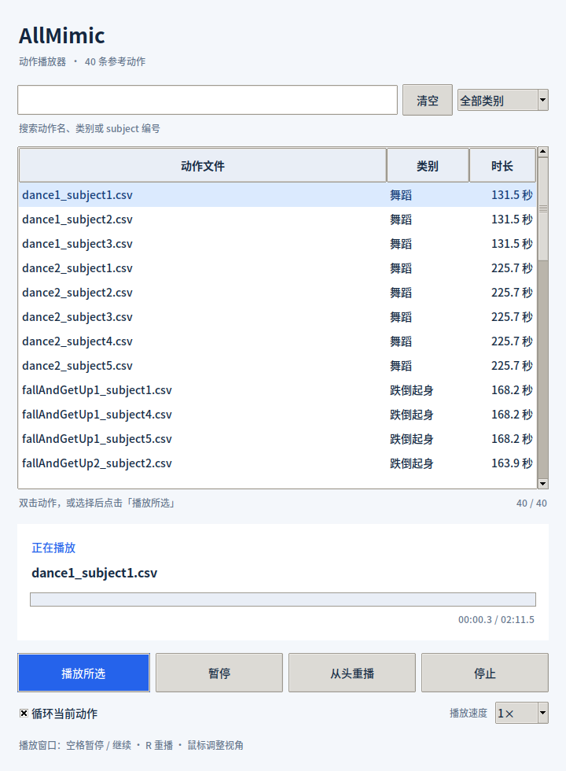

# AllMimic Ubuntu Viewer

Ubuntu 桌面上的 AllMimic 策略播放器，使用 MuJoCo 进行物理仿真，并附带可选择全部 **40 条动作**的 GUI 面板。



## 功能

- 搜索动作名、按类别筛选，查看动作时长。
- 双击动作，或点击「播放所选」，在同一个 MuJoCo 窗口中切换。
- 暂停/继续、从头重播、停止、循环播放和调速。
- 显示当前动作及播放进度。
- 支持无窗口验证；模型和机器人资源包含在仓库中。

## 克隆与安装

已在 Ubuntu 22.04 x86_64 桌面验证。需要可用的 OpenGL、Python 3 引导环境和 Git LFS；首次安装需要联网。

Ubuntu 上可通过系统包管理器安装 Git LFS，以及 GUI 所需的 Tk 和中文字体：

```bash
sudo apt-get install git-lfs libtk8.6 libtcl8.6 fonts-noto-cjk libgl1
git lfs install
git clone https://github.com/Swk6666/allmimic-ubuntu-viewer.git
cd allmimic-ubuntu-viewer
git lfs pull
bash setup.sh
bash run.sh --loop
```

`policy.pt` 和 `motions.npz` 使用 **Git LFS**。直接下载 GitHub 的源码 ZIP 后，需要另外取得这两个文件的真实内容；推荐按以上步骤克隆。

`setup.sh` 将 uv、Python 3.11、PyTorch 和 MuJoCo 安装到本项目的 `runtime/`、`.venv/` 中。默认安装 CUDA 13.0 版 PyTorch；仅需 CPU 版本时使用：

```bash
TORCH_BACKEND=cpu bash setup.sh
```

当前播放器的**策略推理和物理仿真都使用 CPU**。安装 GPU 版 PyTorch 不会自动把播放器切换为 GPU 推理；CPU 版也能运行全部播放器功能。

## 播放与控制

```bash
# 同时打开 MuJoCo 窗口和 40 条动作选择面板
bash run.sh --loop

# 指定初始动作；仍可在面板中切换
bash run.sh --clip dance1_subject1.csv --loop

# 查看全部动作
bash run.sh --list

# 只打开 MuJoCo，不显示选择面板
bash run.sh --no-gui --clip walk1_subject1.csv --loop

# 半速播放，或调整 CPU 推理线程数
bash run.sh --clip walk1_subject1.csv --speed 0.5 --threads 1 --loop
```

MuJoCo 窗口中，**空格**暂停/继续，**R** 从头重播，鼠标调整视角。选择面板提供相应按钮，以及循环和速度选项。关闭任意一个窗口会退出整个播放器。

## 仓库内容

| 路径 | 内容 |
| --- | --- |
| `play.py`、`allmimic/` | 策略加载、观测构造、控制与 MuJoCo 仿真 |
| `motion_gui.py` | 40 条动作选择及播放控制面板 |
| `policy.pt` | 第 18,000 次训练检查点导出的策略、归一化统计与配置，约 35 MiB，Git LFS |
| `motions.npz` | 40 条 50 Hz 的 LAFAN1 G1 参考动作，约 119 MiB，Git LFS |
| `robot/`、`robot_metadata.json` | 机器人场景、XML、STL 网格、关节映射和仿真设置 |
| `gui_runtime/` | CPython 3.11 的本机 Tk 字体适配模块和 Python 许可 |
| `validation/` | 原播放包的四条完整 CPU 动作验证结果 |
| `manifest.json` | 文件大小及 SHA-256 校验清单 |

GUI 字体适配模块面向 Linux x86_64 / CPython 3.11，使用系统 Tk 8.6 的 Xft 字体支持；系统 Tk 不可用时回退到 Python 自带的 Tk。运行环境、安装缓存、PyTorch wheel、临时文件和包含本机信息的报告不纳入版本控制。

## 无窗口检查

```bash
bash run.sh --headless --seconds 10
bash run.sh --headless --clip walk1_subject1.csv
bash run.sh --headless --clip dance1_subject1.csv
bash run.sh --headless --clip fallAndGetUp2_subject2.csv
bash run.sh --headless --clip jumps1_subject2.csv
```

省略 `--seconds` 会检查整条动作。输出的 `failed` 表示是否触发原项目失败条件；`completed_full_clip` 仅在整条动作完成且未失败时为 `true`，失败返回码为 `2`。

本机已验证步行、舞蹈、跌倒起身、跳跃四条完整动作通过，并检查了 GUI 搜索、筛选、动作切换、播放控制和窗口退出。四条动作的验证不代表全部 40 条动作在 CPU 后端都有相同结果。

该策略依赖目标参考动作；它不是仅输入速度命令的通用行走控制器，也不是直接播放参考关节动画。原训练使用 GPU MuJoCo Warp，本播放器使用原生 CPU MuJoCo，两种后端的数值结果可能不同。

## 来源与许可

- 上游代码：[Shimingyi/allmimic](https://github.com/Shimingyi/allmimic)，来源提交 `cb334ff674b2f57248f33f8c21b7fb526fbdf8cc`。策略来源检查点为 `runs/lafan1_target_100/ckpt_0018000.pt`。
- `LICENSE-upstream.txt` 保留上游原始声明：上游派生代码的许可尚未确定。本仓库未为所有组成部分统一指定 MIT 或 Apache 许可。
- mjlab 相关声明见 `LICENSE-mjlab.txt`。
- LAFAN1 数据来源为 [Ubisoft La Forge Animation Dataset](https://github.com/ubisoft/ubisoft-laforge-animation-dataset)；原数据许可为 CC BY-NC-ND 4.0，原文保留在 `LICENSE-LAFAN1.txt`。这里的 `motions.npz` 是 G1 重定向参考动作，保留数据来源与原许可声明。
- Tk Python 适配模块的许可见 `gui_runtime/LICENSE_PYTHON.txt`。

MuJoCo 官方查看器文档：[Python viewer](https://mujoco.readthedocs.io/en/stable/python.html)。
